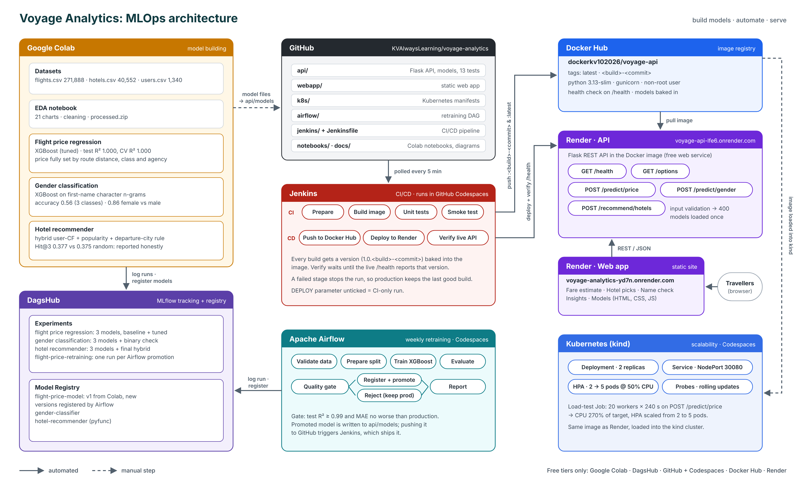

# Voyage Analytics: Integrating MLOps in Travel

End-to-end MLOps capstone (Scaler DSML) built on three travel datasets: **flights**, **hotels** and **users**.
Three models are trained and tracked with MLflow, served through one Flask REST API in Docker, scaled on
Kubernetes, retrained by Apache Airflow, shipped by a Jenkins CI/CD pipeline, and used by a web app.
Everything runs on **free cloud tiers**, with nothing installed on a local machine.

| | Link |
|---|---|
| Web app | https://voyage-analytics-yd7n.onrender.com |
| REST API | https://voyage-api-lfe6.onrender.com (try `/health`) |
| MLflow experiments + model registry | https://dagshub.com/dummy2357dummy/voyage-analytics |
| Docker image | https://hub.docker.com/r/dockerkv102026/voyage-api |

> The Render free tier sleeps after 15 minutes without traffic. The first request after a pause can take up to a minute; the web app shows a "waking up" message while it waits.



---

## Project objectives and where they are met

| # | Objective | Implementation | Where |
|---|---|---|---|
| 1 | Flight price regression model | Linear, Ridge, Random Forest and XGBoost compared with CV and tuning; XGBoost selected | `notebooks/Voyage_Analytics_Flight_Price_Regression.ipynb` |
| 2 | REST API for the regression model | Flask + gunicorn, `POST /predict/price` (plus gender and hotel endpoints), input validation, 13 tests | `api/` |
| 3 | Containerisation | Docker image (python 3.13-slim, non-root user, health check), published to Docker Hub | `api/Dockerfile` |
| 4 | Kubernetes for scalability | kind cluster: Deployment (2 replicas, probes, rolling updates), NodePort Service, HPA 2–5 pods at 50% CPU, load-test Job | `k8s/` |
| 5 | Automated workflows with Apache Airflow | Weekly DAG: validate → prepare → train → evaluate → quality gate → register + promote, or reject → report | `airflow/` |
| 6 | CI/CD with Jenkins | Jenkins as code (JCasC + Job DSL); 7-stage pipeline: build, unit tests, smoke test, push, deploy, verify live version | `Jenkinsfile`, `jenkins/` |
| 7 | Model tracking with MLflow | Every run logged to DagsHub (params, metrics, charts, model); three registered models; Airflow registers new versions | DagsHub |
| 8 | Gender classification model | Character n-gram TF-IDF on first names + XGBoost; served at `POST /predict/gender` | `notebooks/Voyage_Analytics_Gender_Classification.ipynb` |
| 9 | Hotel recommendation model + web app | Hybrid user-based collaborative filtering + popularity, with a departure-city rule; interactive web app (used in place of Streamlit, with approval) | `notebooks/Voyage_Analytics_Hotel_Recommender.ipynb`, `webapp/` |

## Results

**Flight price regression** (271,888 flights; 80/20 split; 5-fold CV)

| Model | Test R² | Test MAE | Test RMSE |
|---|---|---|---|
| Linear Regression | 0.9192 | 81.28 | 103.17 |
| Ridge (tuned) | 0.9192 | 81.28 | 103.17 |
| Random Forest | 0.9947 | 13.99 | 26.31 |
| Random Forest (tuned) | 1.0000 | 0.00 | 0.00 |
| XGBoost | 0.9998 | 3.65 | 4.97 |
| **XGBoost (tuned), selected** | **1.0000** | **0.0002** | **0.0002** |

The near-perfect score is real but needs context: in this dataset the price is completely determined by the route
(distance), flight class and agency, so a tree model can learn the exact pricing rule. XGBoost was preferred over the
tied Random Forest because it refits about 3.5× faster (21 s vs 76 s on the full data), which matters for automated retraining.

**Gender classification** (1,340 users; 3 labels: female, male, none)

| Model | Accuracy | Macro F1 | ROC-AUC (OvR) |
|---|---|---|---|
| Logistic Regression | 0.504 | 0.482 | 0.724 |
| Random Forest | 0.541 | 0.536 | 0.742 |
| **XGBoost (tuned), selected** | **0.560** | **0.541** | **0.730** |

Female vs male alone reaches **0.86** CV accuracy. The "none" label cannot be predicted from a name, which limits the
3-class score. Age and company carry no signal (p = 0.62 and 0.38). The API returns probabilities with a
responsible-use note: the prediction is for aggregate analytics only and never overrides what a user provides.

**Hotel recommender** (40,552 stays, chronological split per user, 8 eligible hotels per trip)

| Model | Hit@1 | Hit@3 | MRR |
|---|---|---|---|
| Random baseline | 0.125 | 0.375 | 0.340 |
| Popularity | 0.127 | 0.371 | 0.340 |
| User-based CF | 0.124 | 0.377 | 0.339 |
| SVD | 0.123 | 0.373 | 0.338 |
| **Hybrid (deployed)** | **0.123** | **0.377** | **0.338** |

No model beats random ranking significantly (all p > 0.05): which hotel a user books next is effectively random in
this synthetic data. The one reliable pattern is that **a traveller never books the hotel in their departure city**,
and the deployed model enforces it as a hard rule. The hybrid model is kept for its explainable suggestions, its full
coverage of hotel partners and its cold-start fallback, not because it scores higher.

**MLOps results**

* **Kubernetes:** under the load test, CPU reached 270% of target and the HPA scaled the API from 2 to 5 pods.
* **Airflow:** the retraining DAG promoted a new model version when it passed the gate, and correctly rejected one when the gate was raised (`min_r2 = 1.5`).
* **Jenkins:** a `git push` triggers a build that is tested, pushed to Docker Hub, deployed to Render, and verified live by its version number.

---

## Repository layout

```
voyage-analytics/
├── notebooks/        Colab notebooks: EDA, flight price, gender, hotel recommender
├── api/              Flask API, model files (api/models), Dockerfile, tests
├── webapp/           Static web app deployed on Render
├── k8s/              kind cluster config and Kubernetes manifests
├── airflow/          Retraining DAG and start script
├── jenkins/          Jenkins image, plugins, Configuration as Code, start script
├── Jenkinsfile       CI/CD pipeline
└── docs/             Architecture diagram
```

## Tech stack

| Layer | Tools |
|---|---|
| Data and modelling | Python, pandas, scikit-learn, XGBoost, SciPy, matplotlib/seaborn (Google Colab) |
| Experiment tracking | MLflow 2.x on DagsHub |
| Serving | Flask, gunicorn, flask-cors |
| Containers | Docker, Docker Hub |
| Orchestration | Kubernetes (kind), kubectl, metrics-server, HPA |
| Workflows | Apache Airflow 2.10 (TaskFlow API, branching) |
| CI/CD | Jenkins LTS (Pipeline, JCasC, Job DSL), GitHub polling, Render deploy hook |
| Hosting | Render (Docker web service + static site), GitHub Codespaces |
| Web app | HTML, CSS, JavaScript, Chart.js |

---

## How to run each part

All commands run in a **GitHub Codespace** of this repository.

### API (Docker)

```bash
cd api
docker build -t voyage-api .
docker run -d --name voyage-api -p 5000:5000 voyage-api
curl localhost:5000/health
curl -X POST localhost:5000/predict/price -H 'Content-Type: application/json' \
     -d '{"from":"Recife (PE)","to":"Florianopolis (SC)","flightType":"firstClass","agency":"FlyingDrops"}'
```

Run the tests inside the image (the tests folder is kept out of the production image):

```bash
docker run --rm -v "$(pwd)":/app/src -w /app/src voyage-api sh -c "pip install -q --user pytest && python -m pytest -q"
```

| Endpoint | Purpose |
|---|---|
| `GET /health` | status of each model, version, uptime, pod name |
| `GET /options` | valid cities, classes, agencies and hotels |
| `POST /predict/price` | `{"from", "to", "flightType", "agency"}` → predicted fare |
| `POST /predict/gender` | `{"name", "age", "company"}` → label + probabilities |
| `POST /recommend/hotels` | `{"userCode", "origin", "destination", "max_price", "k"}` → top-k hotels with reasons |

### Kubernetes

```bash
kind create cluster --config k8s/kind-config.yaml

# metrics-server (needed by the autoscaler); kind needs --kubelet-insecure-tls
kubectl apply -f https://github.com/kubernetes-sigs/metrics-server/releases/latest/download/components.yaml
kubectl -n kube-system patch deployment metrics-server --type=json \
  -p '[{"op":"add","path":"/spec/template/spec/containers/0/args/-","value":"--kubelet-insecure-tls"}]'

# load the API image into the cluster (image-archive avoids a kind/containerd digest error)
docker pull dockerkv102026/voyage-api:latest
docker save --platform linux/amd64 dockerkv102026/voyage-api:latest -o voyage-api.tar
kind load image-archive voyage-api.tar --name voyage

kubectl apply -f k8s/namespace.yaml
kubectl apply -f k8s/deployment.yaml -f k8s/service.yaml -f k8s/hpa.yaml
kubectl get pods,svc,hpa -n voyage
curl localhost:8080/health
kubectl apply -f k8s/load-test.yaml && kubectl get hpa -n voyage -w
```

The load-test Job uses `python:3.12-slim`; load it into kind the same way if its pod shows `ImagePullBackOff`.

### Airflow

```bash
export MLFLOW_TRACKING_URI=https://dagshub.com/<user>/voyage-analytics.mlflow
export MLFLOW_TRACKING_USERNAME=<user>
export MLFLOW_TRACKING_PASSWORD=<dagshub-token>
bash airflow/start_airflow.sh        # UI on port 8081, user admin
```

The retraining data (`airflow/data/flights_clean.csv`) is not committed; it comes from the EDA notebook's `processed.zip`.

### Jenkins

```bash
export DOCKERHUB_USERNAME=<docker-hub-user>
export DOCKERHUB_TOKEN=<docker-hub-token>
export RENDER_DEPLOY_HOOK='<render-api-deploy-hook>'
export RENDER_API_URL=https://voyage-api-lfe6.onrender.com
bash jenkins/start_jenkins.sh        # UI on port 8090, user admin
```

The `voyage-api-ci` job is created automatically and checks GitHub for new commits every 5 minutes.
Use **Build with Parameters → untick DEPLOY** for a CI-only run.

### Notebooks

Open each notebook in Google Colab and upload the CSVs when prompted (Drive is not mounted). Each training notebook
logs to DagsHub when the `DAGSHUB_TOKEN` Colab secret is set, and finishes by downloading a zip with the models, MLflow
runs and figures.

---

## Limitations and next steps

* The flight prices follow a fixed rule, so the regression score is not representative of real-world fares. With real data, the same pipeline (tracking, gate, retraining) applies unchanged.
* Hotel choices in the data are close to random, so personalisation cannot beat chance. Better signals would be dates, prices seen, or reviews.
* Gender is predicted only from first names. It is low-confidence and must not be used for pricing or eligibility.
* Jenkins, Airflow and Kubernetes run in a Codespace, so they are not always on. A permanent setup would move them to a managed service.
* Secrets are passed as environment variables. A production setup would use a secrets manager.

## Author

Para (GitHub: [KVAlwaysLearning](https://github.com/KVAlwaysLearning)) · Scaler DSML capstone project
